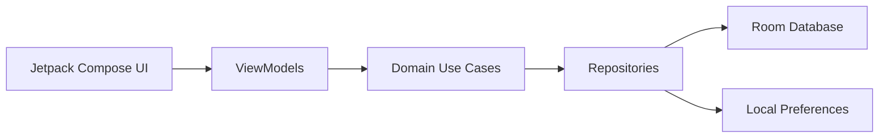

<div align="center">

# MyBuilding

### Building expense and apartment charge management for Android

An offline Android application for managing building units, calculating monthly charges, distributing utility costs, and tracking payments.

<a href="https://myket.ir/app/ir.arminniromandi.mybuilding">
  
</a>
</div>

---

## Overview

MyBuilding is an Android application designed to simplify the monthly financial tasks involved in managing a residential building.

The application allows a building manager to register units and resident counts, enter the monthly water bill and shared building expenses, and calculate the final charge for each apartment.

All application data is stored locally, allowing the main building-management functionality to work without a backend service or internet connection.


## Features

* Building and apartment unit management
* Resident count management for each unit
* Water bill distribution based on the number of residents
* Shared expense distribution across building units
* Monthly apartment charge calculation
* Monthly charge history
* Individual cost records for each apartment
* Paid and unpaid charge tracking
* Local note management
* Automatic detection of a new billing month
* Local offline storage
* Light and dark themes
* Introductory onboarding flow
* Persian user interface

## Charge Calculation

The application calculates each apartment's monthly charge using two separate cost-distribution rules.

### Water bill

The water bill is distributed proportionally based on the number of residents in each apartment:

```text
Apartment water cost =
Apartment resident count × (Total water bill / Total resident count)
```

### Shared expenses

Building expenses such as cleaning and repairs are distributed equally across the registered units:

```text
Apartment shared cost =
Total shared expenses / Total apartment count
```

### Final monthly charge

```text
Final apartment charge =
Apartment water cost + Apartment shared cost
```

The generated monthly charges are stored in the local database together with their corresponding month and apartment records.

## Tech Stack

| Area                  | Technology                     |
| --------------------- | ------------------------------ |
| Language              | Kotlin                         |
| UI                    | Jetpack Compose                |
| Design system         | Material 3                     |
| Architecture          | MVVM with layered architecture |
| Dependency injection  | Hilt                           |
| Local database        | Room                           |
| Asynchronous work     | Kotlin Coroutines and Flow     |
| Navigation            | Navigation Compose             |
| Annotation processing | KSP                            |
| Local preferences     | Android SharedPreferences      |
| Build system          | Gradle Kotlin DSL              |

## Architecture

The project separates application responsibilities into `presentation`, `domain`, and `data` packages.



### Presentation layer

Contains Compose screens, navigation, activities, reusable UI components, and ViewModels.

### Domain layer

Contains application-specific models and business operations, including monthly charge calculation and billing-month detection.

### Data layer

Contains repository implementations, Room database components, DAOs, database entities, dependency-injection modules, and local preferences.

## Project Structure

```text
app/src/main/java/ir/arminniromandi/mybuilding/
├── data/
│   ├── di/                         # Hilt dependency modules
│   ├── local/
│   │   ├── dataBase/
│   │   │   ├── dao/                # Room data access objects
│   │   │   ├── dataModel/          # Database entities and relations
│   │   │   └── DBHandler.kt        # Room database configuration
│   │   └── preferences/            # Local application preferences
│   └── repository/
│       ├── BuildingRepository.kt   # Building and charge operations
│       └── NoteRepository.kt       # Note operations
│
├── domain/
│   ├── model/                       # Business models
│   └── useCase/
│       ├── CalculateMonthlyCostsUseCase.kt
│       └── CheckNeedCreateNewMonthUseCase.kt
│
├── presentation/
│   ├── Activity/                    # Android activities
│   ├── customUi/                    # Reusable Compose components
│   ├── model/                       # Presentation models
│   ├── navigation/                  # Navigation graph and destinations
│   ├── ui/                          # Compose screens
│   └── viewModel/                   # Screen state and event handling
│
├── utils/                           # Date and shared utility classes
└── Application.kt                  # Hilt application entry point
```

## Getting Started

### Requirements

* Android Studio
* JDK 21
* Android SDK 36
* Android device or emulator running Android 8.0 or newer

### Clone the repository

```bash
git clone https://github.com/arminniromandi/myBuilding.git
cd myBuilding
```

### Run the application

1. Open the project in Android Studio.
2. Allow Gradle to download the required dependencies.
3. Select an emulator or physical Android device.
4. Run the `app` configuration.

The application does not require an external API or backend service for its core functionality.

### Building from the command line

Build a debug APK:

```bash
./gradlew assembleDebug
```

Install the debug build on a connected device:

```bash
./gradlew installDebug
```

## Roadmap

* [ ] Unit test coverage for charge-calculation use cases
* [ ] Instrumented tests for Room DAOs
* [ ] Screenshots and demo GIF

## Project Information

| Property        | Value                          |
| --------------- | ------------------------------ |
| Application ID  | `ir.arminniromandi.mybuilding` |
| Minimum SDK     | 26 — Android 8.0               |
| Target SDK      | 36                             |
| Compile SDK     | 36                             |
| Current version | 1.1                            |
| Version code    | 2                              |
| Storage         | Local Room database            |
| Distribution    | Myket                          |

## Myket

The production version of MyBuilding is available on Myket:

[](https://myket.ir/app/ir.arminniromandi.mybuilding)


## Repository Status

This repository is shared as a portfolio project and as a reference for the application's Android implementation.

Release signing credentials, private keys, generated build outputs, and machine-specific configuration files must not be committed to the repository.

## License

No open-source license is currently provided.

Unless a separate `LICENSE` file is added, the source code may not be redistributed, republished, or used commercially without permission from the author.

## Author

**Armin Niromandi**

Android Developer

* [GitHub](https://github.com/arminniromandi)
* [LinkedIn](https://www.linkedin.com/in/arminniromandi)

---

<div align="center">

Built with Kotlin and Jetpack Compose.

</div>
